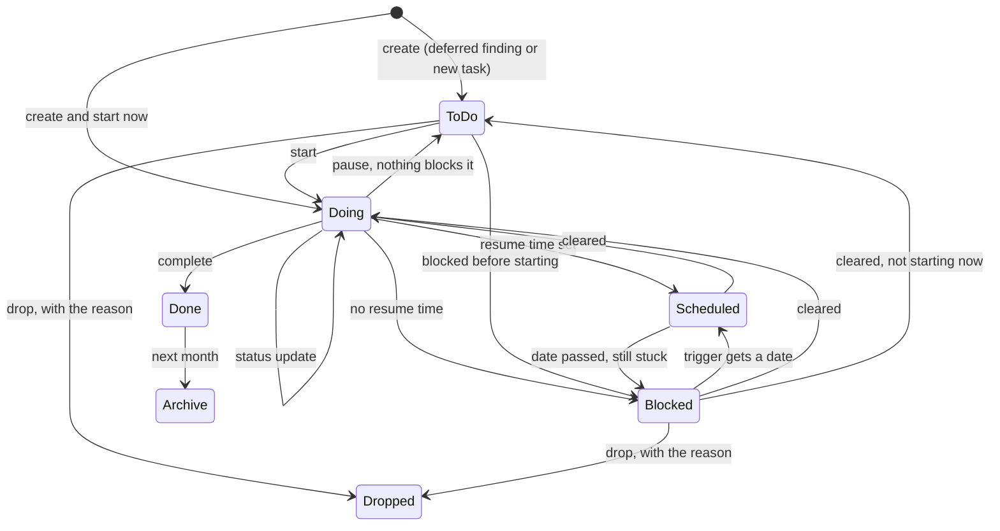

# Kanban

`kanban.md` at the repo root is the one task board shared by every machine and
worktree. Other agents read it to learn what is active, where it runs, and how
to resume it. Every item must make sense to an agent that has none of your
context.

## Board Layout

```text
kanban.md
├── ## 🚧 Doing         tasks someone is working on now
├── ## 📅 Scheduled     paused until a set date or event
├── ## 📋 To Do         tasks ready to start, including deferred findings
│   ├── ### Next        up to 10 items, ranked: work on the top one first
│   └── ### Backlog     everything else, sorted by priority, then size
├── ## 🚫 Blocked       waiting with no known resume time
├── ## ✅ Done          tasks completed this month
└── ## 🗑️ Dropped       tasks dropped after a decision, with the reason
docs/kanban/YYYY-MM.md  completed tasks from earlier months
```

Edit `kanban.md` in the main checkout of the repo, not in a worktree. The board
lives on `main`, and a worktree copy goes stale.

## Item Format

```markdown
- [owner] [P2/M] One-sentence summary of the task. (created YYYY-MM-DD HH:MM ICT on <machine>, <context>)
  - Why or evidence: what prompted it, with file paths, commits, or research notes.
  - Depends on: `[owner] summary start` of the item that must finish first.
  - Status (YYYY-MM-DD HH:MM ICT): current state and the next step.
  - Where: machine `<machine>`, branch `<branch>`, worktree `<path>`.
  - Resume: `cd <path> && cat docs/plans/YYMM/DDHHMM-<name>/progress.md`.
```

- **Owner tag:** the service or area, in square brackets, such as `[trader]`,
  `[fetch]`, or `[deploy]`.
- **Priority and size tag:** in square brackets after the owner, as
  `[<priority>/<size>]`. Every item in Doing, Scheduled, To Do, and Blocked
  has one.
  - `P1`: protects money or correctness in live trading, or other items wait
    on it. `P2`: worth doing this month. `P3`: nice to have, someday.
  - `S`: under about an hour. `M`: about one session. `L`: several sessions,
    needs a plan (see the `plan-tracking` skill).
  - Guess when unsure and fix the tag later; a rough tag beats none.
- **Summary:** state the task or the problem, not the activity. "Auction
  writes pay DNS+TCP+TLS on almost every order" is better than "look at
  latency".
- **Origin:** the created stamp also names the machine (from `hostname`) and
  the context: the branch or worktree, plus the task or plan that turned up
  the item. Example:
  `(created 2026-11-22 10:15 ICT on air-m1, worktree auction-profit-tiers, while planning the profit-tier buffer)`.
- **Timestamps:** use `YYYY-MM-DD HH:MM ICT`. Get it with
  `TZ=Asia/Ho_Chi_Minh date '+%Y-%m-%d %H:%M ICT'`. Add `started`, `updated`,
  and `completed` to the same parentheses as they happen, so the stamps stay
  together.
- **Depends on:** add one line per item that must finish first, quoting the
  start of its summary so a search finds it. Leave it out when nothing must
  finish first. Do not use it for a wait on something outside the board; that
  is `Waiting on`.
- **To Do items** need the summary, origin, and enough context to act on later.
  `Where` and `Resume` are optional until work starts.
- **Doing items** must have `Where` and `Resume`. Link the plan folder
  when one exists (see the `plan-tracking` skill).
- **Scheduled and Blocked items** must have a `Waiting on` line and a `Revisit`
  line, and keep `Where` and `Resume` if work had started:
  - `Waiting on:` the one thing that stops the next step, such as a user
    decision, a market event, an upstream fix, or another item. Name it so
    anyone can check whether it has happened.
  - `Revisit:` a date (`YYYY-MM-DD`) or a checkable trigger, such as "after
    the 2027-02-15 index review" or "when `[trader]` buffer item is Done".
- **Scheduled or Blocked:** Scheduled means the resume time is set in advance:
  `Revisit` is a date, or an event with a known date, such as the next ATO or
  a scheduled index review. Blocked means waiting with no known resume time,
  such as a vendor change or an upstream fix; its `Revisit` is a trigger you
  can check, not a date. When a Blocked item's trigger gets a date, move it to
  Scheduled. When a Scheduled item reaches its date and still cannot resume,
  set a new date or move it to Blocked.
- Use To Do, not Scheduled or Blocked, when nothing stops the task and it only
  lacks time.

## Lifecycle



1. **Create.** When you find work outside the current task, such as a bug, a
   risk, or a follow-up you are deferring, add it to To Do without asking.
   Name it in your final response.
2. **Start.** Move the item to Doing, add `started`, `Where`, and
   `Resume`. Any task you work on needs a Doing item, even one you
   created a minute ago.
3. **Update.** When the state changes, such as a plan written, waiting on the
   human, merged, or deployed, edit the item's `Status` line in place and bump
   `updated`. Keep only the current status plus the facts a resumer needs.
   History belongs in the plan's `progress.md` and in git.
4. **Pause or wait.** If you stop without finishing, keep `Resume` exact. If
   something stops the task, move it to Scheduled or Blocked with `Waiting on`
   and `Revisit`, and add `scheduled since` or `blocked since` to the stamps. Otherwise move it back to To Do.
5. **Complete.** Move the item to the top of Done. Shrink it to a summary of
   the outcome: what shipped (merge SHA), whether it is deployed, and the plan
   link. Add `completed`. Search the board for `Depends on` lines that quote
   this item and remove them; if one of those items was Blocked on it, move
   it to To Do.
6. **Drop.** Move a task you decide not to do to Dropped, with a
   `Dropped (timestamp):` line that says why.

## Choosing What to Do Next

Run `hostname`, then read the Machines section of
`docs/ai_context/operations.md` to learn what this machine usually does.
Scan Scheduled, then Blocked, first: if an item's `Waiting on` has happened
or its `Revisit` date has passed, move it to To Do or Doing, or bump `Revisit`
with the reason. Then take the highest item in Next that fits this machine and
has no open `Depends on`.

**Keeping Next ranked.** Next holds at most 10 items, ranked by the human. An
agent may add a new `P1` item to Next, at the bottom, and say so in its final
response; any other change to the order needs the human. When Next has fewer
than 5 items, propose candidates from Backlog to the human. Keep Backlog
sorted by priority, then size, so the small high-value work is on top.

## Commit and Push

Commit and push the board as soon as task state changes, so other machines see
it. Agents may push `kanban.md` to `main` without asking. Commit nothing else
in the same commit.

```bash
cd <main checkout>
git pull --rebase=merges origin main
# edit kanban.md
git add kanban.md
git commit -m "chore(kanban): <start|update|complete|add> <short item name>"
git push origin main
```

If the push is rejected, run `git pull --rebase=merges origin main` and push
again. If the rebase conflicts in `kanban.md`, keep both sides' items and
re-sort them; never drop another agent's item.

## Monthly Archive

On the first board edit of a new month, move every Done item completed in an
earlier month to `docs/kanban/YYYY-MM.md` for the month it completed, creating
the file if needed. Newest first, as on the board. Commit this as its own
`chore(kanban): archive YYYY-MM` commit.
